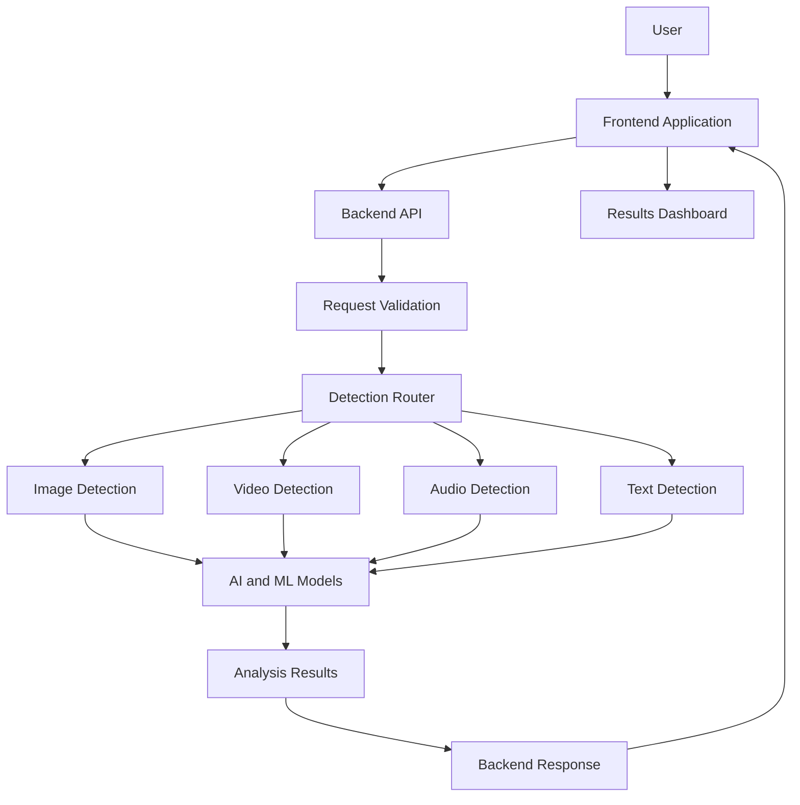

# AI VS REAL — AI-Generated Content Detection System

An AI-powered multi-modal content authenticity detection system designed to analyze digital media and identify patterns associated with AI-generated, synthetic, manipulated, or potentially authentic content.

---

## About the Project

AI VS REAL is a multi-modal AI detection platform developed to explore and analyze the authenticity of digital content in an era where artificial intelligence can generate highly realistic images, videos, audio recordings, and text.

The system brings multiple detection capabilities into a single platform, allowing users to submit different types of digital content for analysis.

Instead of relying on visual inspection alone, the platform uses machine learning, deep learning, content analysis, signal processing, and statistical techniques to examine characteristics that may indicate AI generation or manipulation.

The goal of this project is to provide a centralized, accessible, and intelligent platform for digital media authenticity analysis.

---

## Abstract

The rapid development of generative artificial intelligence has made it increasingly difficult to distinguish AI-generated content from human-created or naturally recorded media.

Modern generative models can create realistic photographs, videos, speech, and written content. These technologies have useful applications but also introduce challenges related to misinformation, impersonation, manipulated media, digital trust, and content verification.

AI VS REAL aims to address this problem through a multi-modal detection platform capable of analyzing different content types using specialized detection approaches.

The system combines dedicated detection modules, AI models, statistical analysis, signal-processing techniques, and a web-based interface to provide users with understandable analysis results.

The platform is designed to support digital content verification, AI awareness, research, experimentation, and responsible media analysis.

---

## Problem Statement

The availability of advanced generative AI tools has significantly increased the production of synthetic digital content.

Identifying whether digital content is AI-generated or authentic has become a challenging task because:

- AI-generated content can appear highly realistic.
- Manipulated images and videos may be difficult to identify visually.
- AI-generated voices can resemble real human speech.
- AI-generated text may appear natural and contextually accurate.
- Different content formats require different detection techniques.
- Existing detection approaches may be limited to a single content modality.
- Detection results are not always reliable across different AI generation models.

There is a need for a centralized platform capable of analyzing multiple types of content and providing useful authenticity-related information.

---

## Objectives

The primary objectives of AI VS REAL are:

- Develop a multi-modal AI-generated content detection platform.
- Analyze images, videos, audio, and text.
- Integrate specialized detection approaches for different media types.
- Provide understandable detection results.
- Display confidence or probability scores where supported.
- Identify suspicious patterns and potential synthetic characteristics.
- Provide an interactive and user-friendly interface.
- Support responsible digital content verification.
- Make AI authenticity analysis more accessible.
- Create an extensible architecture for integrating additional detection models.

---

## Key Features

### Multi-Modal AI Detection

Analyze multiple types of digital content through a centralized platform.

### Image Detection

Analyze image characteristics and patterns that may be associated with AI-generated imagery or manipulated images.

### Video Detection

Analyze video content using supported video-processing and frame-analysis techniques.

### Audio Detection

Analyze audio signals, spectral characteristics, statistical patterns, and other supported audio features.

### Text Detection

Analyze text using supported linguistic, statistical, and machine-learning approaches to estimate whether content may have been generated by AI.

### AI-Based Analysis

Use machine-learning and deep-learning models where implemented to assist in identifying synthetic or manipulated content.

### Interactive User Interface

Provide a user interface for submitting content, viewing analysis, and interacting with results.

### Detailed Results

Display detection outcomes, analysis information, scores, and relevant visualizations supported by the detection module.

### File Upload and Processing

Allow supported files to be submitted for analysis, subject to configured file types, sizes, and processing limits.

### Modular Architecture

Separate detection modules and processing components to support development, maintenance, and future model integration.

---

## Detection Modules

### 1. Image Detection

The image detection module is designed to analyze image files and identify patterns that may be associated with AI-generated imagery.

Possible analysis areas include:

- Image feature analysis
- Visual artifact detection
- Statistical image characteristics
- AI-generated image pattern analysis
- Model-based classification
- Image authenticity assessment

**Supported formats:** Depends on the implemented image-processing pipeline.

**Output:** Image analysis result, classification, and confidence information where available.

---

### 2. Video Detection

The video detection module is designed to analyze video content and identify characteristics associated with synthetic or potentially manipulated media.

The analysis may include:

- Video file processing
- Frame extraction
- Frame-level analysis
- Visual consistency analysis
- Temporal characteristics
- AI-generated video pattern analysis

Video detection may use frame-based image analysis or dedicated video analysis models, depending on the implementation.

**Output:** Video authenticity assessment and analysis results supported by the system.

---

### 3. Audio Detection

The audio detection module analyzes audio recordings to identify characteristics that may indicate synthetic speech or AI-generated audio.

The audio analysis pipeline may include:

- Audio preprocessing
- Audio waveform analysis
- Spectral analysis
- Synthetic speech detection
- Voice consistency analysis
- Audio quality assessment
- Statistical anomaly analysis

The audio detection system includes the following detector categories:

| Detector | Purpose |
|---|---|
| Synthetic Speech CNN | Analyze audio characteristics associated with synthetic speech |
| Spectral Artifact Analysis | Examine frequency-domain patterns |
| Voice Consistency Analysis | Analyze consistency-related characteristics |
| Audio Quality Analysis | Evaluate audio quality-related characteristics |
| Statistical Anomaly Detection | Identify unusual statistical patterns |

Supported audio formats in the audio module include:

- WAV
- MP3
- M4A
- FLAC
- OGG
- OPUS
- WebM

Audio analysis results may be categorized as:

- Likely Synthetic
- Likely Human-Recorded
- Possible Manipulation
- Inconclusive

The system may also provide waveform visualizations, frequency-related visualizations, audio playback, and analysis exports where implemented.

---

### 4. Text Detection

The text detection module is designed to analyze written content and estimate whether it may have been generated by an AI model.

Possible analysis areas include:

- Linguistic patterns
- Text structure
- Statistical characteristics
- Language-model-related patterns
- Text classification
- AI-generated writing indicators

The module is intended to assist users in understanding characteristics of submitted text.

Text detection is probabilistic and cannot reliably prove that a particular text was written by a human or an AI.

---

## System Architecture

AI VS REAL follows a modular architecture consisting of a frontend, backend, detection services, AI models, and supporting infrastructure.



### Architecture Components

**Frontend**

Responsible for user interaction, content submission, displaying results, and visualizing analysis information.

**Backend**

Responsible for API requests, validation, processing, coordinating detection services, and returning analysis results.

**Detection Services**

Contain the processing and analysis logic for individual content types.

**AI/ML Models**

Perform supported classification, feature analysis, and detection tasks.

**Storage and Infrastructure**

Handle application data, configuration, and file storage where implemented.

---

## Technology Stack

The project uses technologies from web development, artificial intelligence, machine learning, media processing, and data analysis.

| Category | Technology |
|---|---|
| Backend Framework | FastAPI |
| Backend Language | Python |
| Frontend | React |
| Frontend Language | JavaScript / TypeScript, as implemented |
| API Architecture | REST API |
| AI / ML | Machine Learning and Deep Learning |
| Computer Vision | Image and Video Processing |
| Audio Processing | Digital Audio Analysis |
| Text Analysis | NLP and Text Classification |
| Visualization | Interactive Charts and Media Visualizations |
| Database | Configured Database / Supabase, where integrated |
| Development Environment | Visual Studio Code |
| Version Control | Git |
| Repository Hosting | GitHub |

*The exact technology and dependency versions should be verified against the project configuration files.*

---

## Project Workflow

The general workflow of the platform is:

1. The user opens the AI VS REAL web application.
2. The user selects a content type.
3. The user uploads a file or submits text.
4. The frontend sends the request to the backend API.
5. The backend validates the input.
6. The appropriate detection module is selected.
7. The module preprocesses the content.
8. The supported AI/ML models and analysis methods process the input.
9. The detection module generates its result.
10. The backend returns the result to the frontend.
11. The frontend displays the result and supported analysis information.

---

## AI and Machine Learning

AI VS REAL uses specialized analysis approaches depending on the content being processed.

The project may involve:

- Machine Learning classification
- Deep Learning
- Neural Networks
- Convolutional Neural Networks (CNN)
- Statistical analysis
- Signal processing
- Computer Vision
- Natural Language Processing (NLP)
- Feature extraction
- Model-based inference

Each detection module may use different models, features, and preprocessing methods.

The system is designed to support independent development and improvement of individual detection models.

---

## Repository Structure

The repository contains multiple detection modules and supporting application components.

The following is a conceptual structure. Actual directory names and files may differ.

```text
AIdetection/
│
├── README.md
│
├── backend/
│   ├── app/
│   │   ├── api/
│   │   ├── models/
│   │   ├── services/
│   │   ├── utils/
│   │   └── main.py
│   ├── requirements.txt
│   └── ...
│
├── frontend/
│   ├── src/
│   ├── public/
│   ├── package.json
│   └── ...
│
├── image-detection/
│   └── ...
│
├── video-detection/
│   └── ...
│
├── audio-detection/
│   └── ...
│
├── text-detection/
│   └── ...
│
├── docs/
│   └── ...
│
├── tests/
│   └── ...
│
└── .gitignore
```

---

## Installation Requirements

Before running the project, ensure that the following software is installed:

- Python 3.10+ (use the version compatible with the backend)
- Node.js and npm
- Git
- Visual Studio Code
- A compatible web browser
- Sufficient disk space for dependencies and AI models

Additional requirements may depend on the selected detection module and AI models.

---

## Installation and Setup

### 1. Clone the Repository

```bash
git clone https://github.com/info01abhishek-max/AIdetection.git
```

### 2. Open the Project

```bash
cd AIdetection
```

Open the repository in Visual Studio Code.

### 3. Configure Environment Variables

Create the required `.env` files according to the backend and frontend configuration.

Example:

```env
# Backend Configuration
APP_ENV=development
APP_HOST=127.0.0.1
APP_PORT=8000

# Database Configuration
DATABASE_URL=

# Supabase Configuration (if required)
SUPABASE_URL=
SUPABASE_ANON_KEY=
SUPABASE_SERVICE_KEY=

# AI Model Configuration
MODEL_PATH=
```

Do not commit API keys, passwords, secret tokens, or private credentials to GitHub.

---

## Backend Setup

Navigate to the backend directory:

```bash
cd backend
```

Create a Python virtual environment:

```bash
python -m venv venv
```

Activate the virtual environment on Windows:

```bash
venv\Scripts\activate
```

Install dependencies:

```bash
pip install -r requirements.txt
```

Start the backend using the actual entry point configured in the project.

Example FastAPI command, if `app.main` exposes the FastAPI application:

```bash
uvicorn app.main:app --reload
```

The default development server is commonly available at:

```text
http://127.0.0.1:8000
```

API documentation, when enabled:

```text
http://127.0.0.1:8000/docs
```

---

## Frontend Setup

Navigate to the frontend directory:

```bash
cd frontend
```

Install dependencies:

```bash
npm install
```

Start the development server:

```bash
npm run dev
```

The frontend address depends on the configured development server and may commonly be:

```text
http://localhost:5173
```

---

## Running the Project

The frontend and backend generally need to run separately during local development.

### Terminal 1 — Backend

```bash
cd backend
```

Activate the virtual environment:

```bash
venv\Scripts\activate
```

Start the backend:

```bash
uvicorn app.main:app --reload
```

### Terminal 2 — Frontend

```bash
cd frontend
npm install
npm run dev
```

Open the frontend development URL shown in the terminal.

*Commands may need adjustment based on the actual entry points and project configuration.*

---

## API Documentation

The backend provides API endpoints for content submission, detection processing, and returning analysis results.

API functionality may include:

- Image detection
- Video detection
- Audio detection
- Text detection
- Health checks
- Detection status
- File processing
- Analysis results

The exact endpoints, request schemas, and response structures are defined in the backend implementation.

FastAPI Swagger documentation may be available at:

```text
/docs
```

Alternative API documentation may be available at:

```text
/redoc
```

---

## Configuration

The project may use configuration values for:

- Backend server settings
- Frontend API URLs
- File upload limits
- File processing limits
- Model configuration
- Storage configuration
- Database connections
- Logging
- Temporary file management
- Development and production environments

Configuration should be maintained through environment variables and appropriate configuration files.

Sensitive values should never be committed to the public repository.

---

## Security and Privacy

AI VS REAL processes digital content submitted for analysis.

Security and privacy considerations include:

- Validate uploaded files.
- Restrict supported file types.
- Apply upload size limits.
- Handle temporary files securely.
- Avoid exposing private credentials.
- Protect API endpoints.
- Avoid unnecessary storage of user content.
- Configure database permissions appropriately.
- Do not expose privileged database keys in the frontend.
- Handle errors without exposing sensitive internal information.

Users should only upload content that they are permitted to process.

---

## Testing

Testing should cover individual detection modules and the overall application.

Testing areas may include:

- Backend API tests
- Frontend tests
- Image processing tests
- Video processing tests
- Audio processing tests
- Text analysis tests
- File validation tests
- Error handling
- Integration tests
- Database integration
- Model inference testing

Test execution commands depend on the frameworks configured in the repository.

---

## Limitations

AI-generated content detection is an evolving research and engineering field.

The system may have the following limitations:

- Detection results are not guaranteed to be accurate.
- AI-generated content may be incorrectly classified as authentic.
- Human-created content may be incorrectly classified as AI-generated.
- Different generative models may produce different patterns.
- Compression, editing, resizing, noise, and transformations can affect detection.
- Detection performance may vary depending on the input content.
- Model performance depends on training data and evaluation methodology.
- A confidence score does not necessarily represent the true probability of authenticity.

AI VS REAL should be used as an analysis and decision-support tool, not as definitive proof of authenticity or manipulation.

---

## Future Scope

Potential future improvements include:

- Improved detection accuracy
- Integration of additional AI detection models
- Advanced deepfake detection
- Real-time media analysis
- Improved temporal video analysis
- Better audio spoofing analysis
- Enhanced NLP-based text analysis
- Explainable AI
- Model comparison and ensemble detection
- Improved visual analytics
- Detection history and reporting
- Additional supported file formats
- Cloud deployment and scalability
- Performance optimization
- More comprehensive testing and benchmarking

---

## Responsible Use

AI VS REAL is intended for educational, research, analytical, and responsible digital media verification purposes.

Detection results should be interpreted carefully. The system should not be used as the sole basis for making critical decisions about individuals, accusations, disciplinary action, or the authenticity of important evidence.

Always consider context, original sources, independent verification, and the limitations of AI detection technology.

---

## Contributing

Contributions, suggestions, bug reports, and improvements are welcome.

If you would like to contribute:

1. Fork the repository.
2. Create a new branch.
3. Make your changes.
4. Test your implementation.
5. Submit a pull request describing your changes.

Please ensure that contributions do not introduce unnecessary breaking changes, expose credentials, or remove existing functionality without appropriate review.

---

## Author

**Abhishek Kumar**

B.Tech Computer Science and Engineering  
Cyber Security

Project: AI VS REAL — AI-Generated Content Detection System

GitHub:

https://github.com/info01abhishek-max/AIdetection

---

## License

The license and permissions for this project depend on the license file included in the repository.

If no LICENSE file exists, the project should not be assumed to have an open-source license permitting unrestricted reuse.

---

## Disclaimer

AI VS REAL provides AI-assisted analysis of digital content.

The system cannot guarantee the authenticity, origin, or integrity of any image, video, audio recording, or text.

Detection results are estimates generated by computational methods and should be interpreted with caution.

---

## Acknowledgements

This project builds upon the broader development of artificial intelligence, machine learning, deep learning, digital media processing, computer vision, natural language processing, and open-source software technologies.
